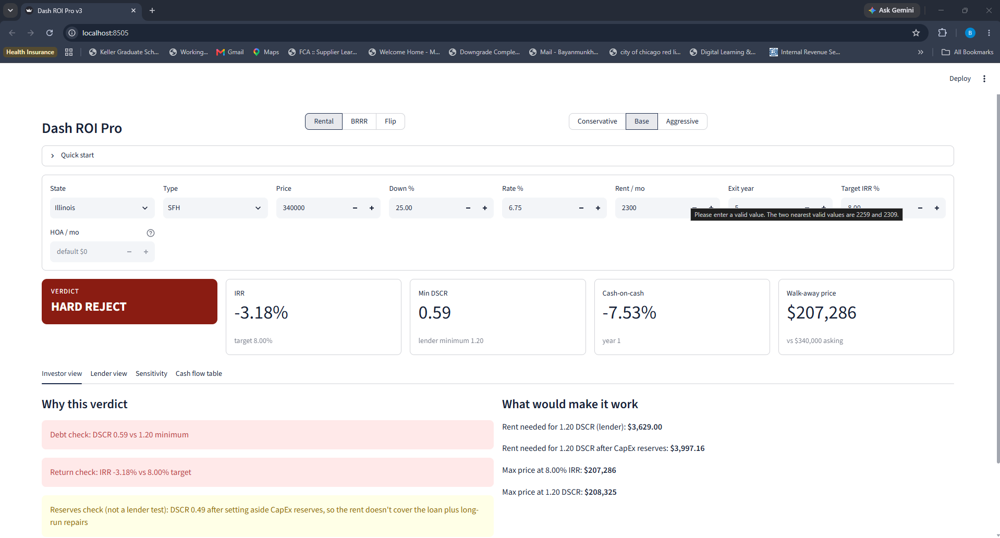
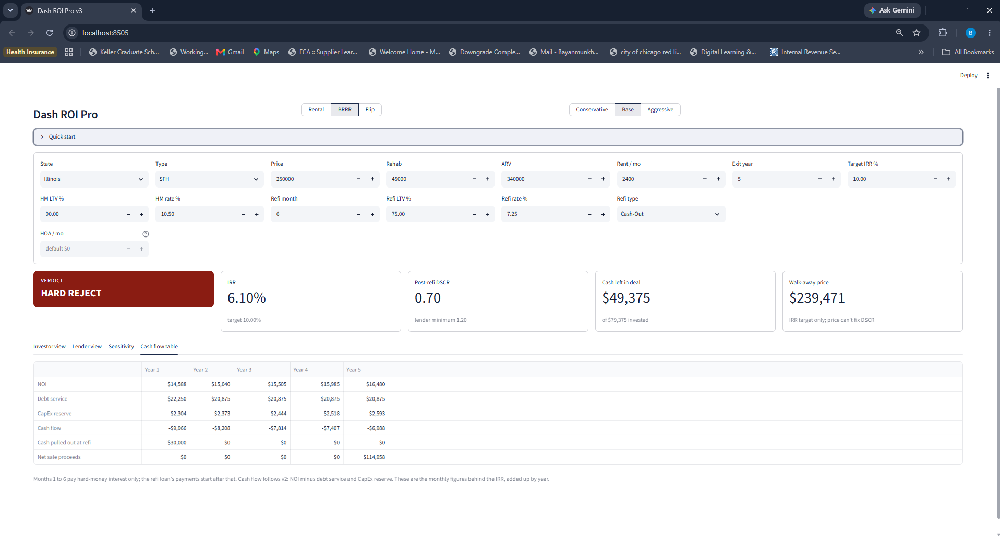
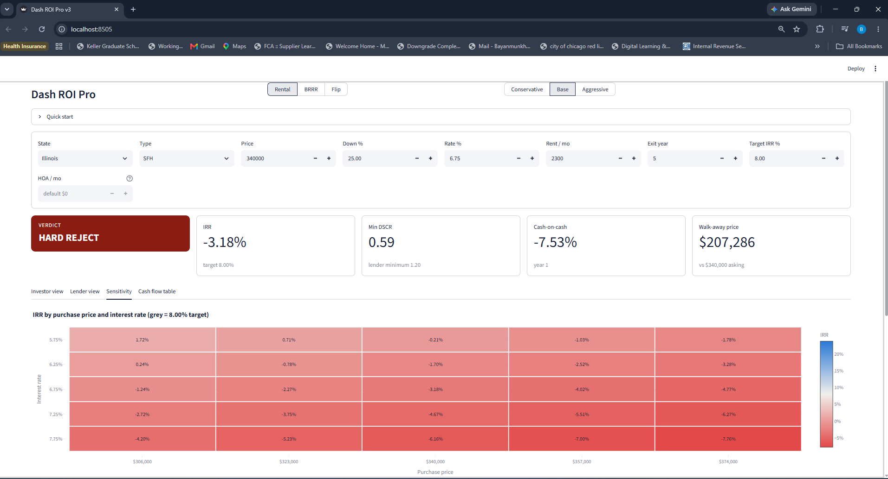
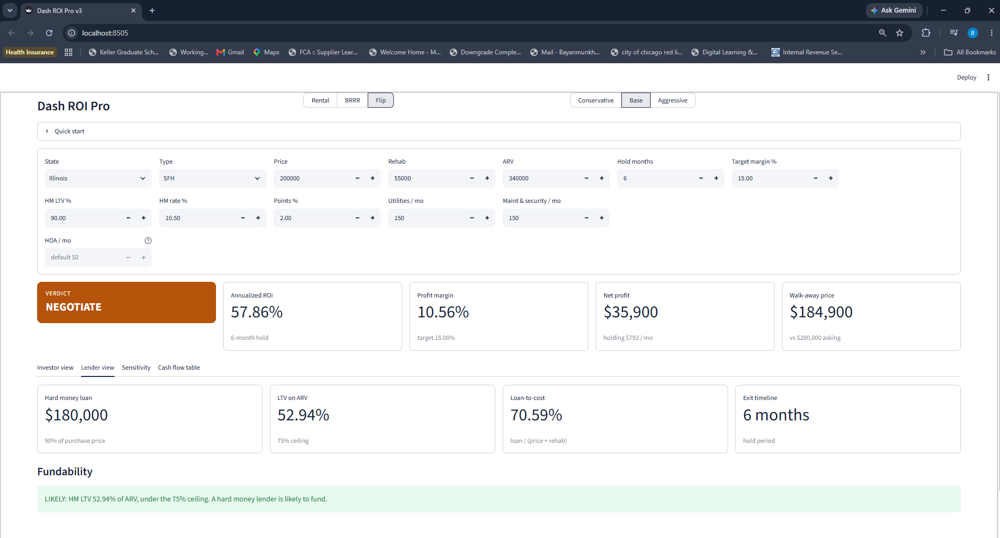

# Dash ROI Pro v3

A web app for screening residential real estate deals as a **Rental**, **BRRR**
(buy, rehab, rent, refinance, repeat) or **Flip**. It is a Python and Streamlit
rebuild of Dash ROI Pro v2, an Excel/VBA analysis tool, with every engine
checked against the v2 numbers.

Each deal gets a verdict, the reasons behind it, a lender's view, the highest
price that still meets the investor's target, sensitivity charts and a full
cash flow table.



## Features

- **Three models, one page.** Rental, BRRR and Flip, each with Conservative,
  Base and Aggressive scenarios. Tax, insurance, HOA, vacancy and growth rates
  come from an assumption table by state (CA, IL) and property type.
- **Verdicts with reasons.** DSCR is the hard gate for Rental and BRRR; Flip is
  judged on profit margin against a 10% floor and the user's target.
- **Walk-away price.** Solvers find the highest price that meets the target IRR
  or a 1.20 DSCR (Rental), the IRR target (BRRR), or the max allowable offer (Flip).
- **Required rent on two bases:** the lender's 1.20 DSCR, and 1.20 after
  setting aside CapEx reserves.
- **Lender view.** Loan sizing, NOI, debt service, DSCR and a fundability rating.
- **Sensitivity.** A 2-way IRR heatmap (price × rate) and a tornado chart for
  Rental; a BRRR tornado on ARV, refi LTV and post-refi rate.
- **Cash flow table.** Yearly for Rental and BRRR, a cost breakdown for Flip.
- **BRRR refi options.** Cash-out or rate/term refinance.
- **HOA override.** Blank uses the assumption-table default; any number replaces it.



## Architecture

```
app.py            Streamlit page: inputs, tiles, tabs. No financial maths.
engine/
  analyze.py      analyze_deal(): single entry point, routes by model
  rental.py, brrr.py, flip.py, projection.py, amortization.py, deal.py
  irr.py          IRR by bisection, bounded for streams up to 30 years monthly
  solvers.py      max-price solvers (bisection on price)
  verdict.py      verdict ladders and lender fundability
  sensitivity.py  2-way grid and tornado charts
  assumptions.py  assumption-table lookup
  guards.py       input validation
  crosscheck.py   side-by-side comparison with the v2 workbook
tests/            pytest suite
Assumption.csv    assumptions by state, property type, model and scenario
```

Three rules hold the design together:

1. **The page never calculates.** Every number on screen comes from
   `analyze_deal()` or a solver, so the page and the tests see the same figures.
2. **One source per number.** The cash flow tables are built from the same rows
   the IRR uses, so the table and the IRR cannot disagree.
3. **Separate engines per model.** BRRR and Flip have their own engines rather
   than reusing Rental logic, because their cash flows differ in kind.

## Testing

```
python -m pytest -q
```

327 tests, running in a few seconds:

| Group | What it checks |
|---|---|
| Regression | Rental, BRRR and Flip cases carried over from the v2 test plan, matched to v2's recorded figures |
| Crosscheck | Engine and solver outputs against the v2 workbook, each marked MATCH, DOCUMENTED or LOCKED |
| Sweep | Every model, state, property type and scenario (72 combinations) plus hold periods of 1 to 30 years |
| Round-trip | Solver prices and required rents fed back into the deal land exactly on their targets |
| Features | Rate/term refi, HOA override, tornado, cash flow tables, lender rules |

The sweep found two real bugs that single-deal testing had missed: the IRR
search crashed on BRRR holds of 7 years and longer, and overflowed on 25 to 30
year holds. Both are fixed and covered by tests.



## Design decisions

Where v3 differs from v2, the change is deliberate and recorded:

- HOA and maintenance escalate with inflation; CapEx is linked to rent every year.
- BRRR required rent uses the refi loan, not the purchase loan.
- BRRR all-cash-out price uses the exact formula
  (ARV × refi LTV − rehab) ÷ (1 + closing %).
- BRRR lender fundability uses the refi LTV.
- The v2 DSCR solver stopped slightly early; v3 solves to the exact 1.20 price.

## Run it

```
pip install -r requirements.txt
python -m streamlit run app.py
```

